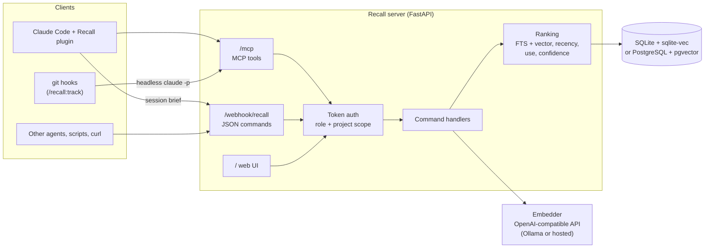

# Recall

A self-hosted memory server that a team's AI coding agents share.

[](LICENSE)
[](setup.py)
[](https://github.com/gshepptech/recall/actions/workflows/ci.yml)

Coding agents start every session knowing nothing about your codebase. Recall gives
them one memory they all share: conventions, decisions, requirements and known errors,
stored on a server you run. Agents read and write it through MCP tools or plain HTTP.
The Claude Code plugin briefs each new session from that memory and updates it every
time someone commits.

## Features

- **Session-start brief.** A SessionStart hook loads the current repo's top facts and
  the team's global conventions into every new Claude Code session.
- **Incremental indexing on commit.** `/recall:track` installs git `post-commit` and
  `post-merge` hooks. Each commit runs a headless pass over the changed files and saves
  the facts it can back with at least two `file:line` citations.
- **Deep codebase reads.** `/recall:scour` splits a repo into slices, reads each one with
  a reader agent, checks the results with a skeptic agent, and asks you about anything
  ambiguous before it writes.
- **Retrieval confidence and a relevance floor.** Every fact stores a confidence score
  that lowers its rank. Search results carry a `relevance` value, and matches below
  `RECALL_MIN_RELEVANCE` (or a per-request `min_relevance`) are suppressed instead of
  returned as if they were good.
- **Token-safe connect.** You save the token once with a silent terminal prompt, and
  `/recall:connect` reads it from `~/.recall/token`. The token never enters the chat.
- **Shared, scoped memory.** Projects keep facts apart, and a `global` project holds
  team-wide conventions. Tokens carry a role (owner, admin, developer, viewer) and can be
  limited to one project.
- **Hybrid search, local if you want it.** Search combines full-text and vector
  similarity, then adjusts for age and use. It runs keyword-only with no embedder, or
  semantic with a bundled local Ollama model, so no data leaves your network.

## Quick start

You need Docker with Compose v2.

```bash
git clone https://github.com/gshepptech/recall && cd recall
./install.sh                 # writes .env with random secrets, starts Postgres and Recall
./install.sh embedder        # optional: local Ollama embedder for semantic search
./install.sh add-user alice developer   # mint a token for a teammate
```

`install.sh` prints the owner token when the server is up at `http://localhost:8000`.

Each person then connects Claude Code. First, in a terminal, save the server URL and
token. The token prompt does not echo:

```bash
read -rp 'Recall URL (http://host:8000): ' U; read -rsp 'Recall token: ' T; echo; \
mkdir -p ~/.recall; printf 'RECALL_URL=%s\nRECALL_TOKEN=%s\n' "$U" "$T" > ~/.recall/token; \
chmod 600 ~/.recall/token; unset T
```

Then, inside Claude Code:

```
/plugin marketplace add gshepptech/recall
/plugin install recall@recall
/recall:connect
```

Restart Claude Code. The `recall_*` tools and the session brief load from the next
session. Run `/recall:scour .` once to seed a repo and `/recall:track` to keep it
current. After that, ask in plain language: "remember that we return Result types at
service boundaries", or "what did we decide about the auth flow?"

The full walkthrough, including roles and troubleshooting, is in
[docs/setup.md](docs/setup.md).

## How it works



The server is one Python process. Agents call it over MCP (Streamable HTTP at `/mcp`)
or send JSON commands to `/webhook/recall`. Each request is checked against a token's
role and optional project scope before it reaches a handler. Saves embed the title
and content when an embedder is configured. Searches run full-text and vector queries,
merge them, then re-rank by age, access count and stored confidence. If the embedder
is missing or fails, search falls back to keyword-only and the response is marked
`degraded`.

SQLite is the default for a single machine. The Docker stack uses PostgreSQL with
pgvector so several agents can write at once. See [docs/architecture.md](docs/architecture.md)
for the data model and request flow.

## Configuration

Settings are read from `.env` (see [.env.example](.env.example)). The main ones:

| Variable | Default | Purpose |
|---|---|---|
| `RECALL_TOKEN` | none | Owner token. Only this token can mint other tokens. |
| `RECALL_HOST` / `RECALL_PORT` | `0.0.0.0` / `8000` | Bind address and port |
| `RECALL_DB_BACKEND` | `sqlite` | `sqlite` or `postgres` |
| `RECALL_DB_PATH` | `./recall.db` | SQLite file |
| `RECALL_DB_HOST`, `RECALL_DB_PORT`, `RECALL_DB_NAME`, `RECALL_DB_USER`, `RECALL_DB_PASSWORD` | `localhost`, `5432`, `recall`, `recall`, empty | PostgreSQL connection |
| `RECALL_EMBEDDING_API_BASE` | `https://api.openai.com/v1` | Any OpenAI-compatible embeddings endpoint, such as Ollama at `http://ollama:11434/v1` |
| `RECALL_EMBEDDING_API_KEY` | none | Embedder key. Leave it empty for keyword-only search. |
| `RECALL_EMBEDDING_MODEL` | `text-embedding-3-small` | Embedding model name |
| `RECALL_EMBEDDING_DIM` | `1536` | Vector size. It must match the model, for example 768 for `nomic-embed-text`. |
| `RECALL_MIN_RELEVANCE` | `0.0` | Relevance floor from 0 to 1. `0` turns it off. |
| `RECALL_DECAY_DAYS` | `30` | Half-life, in days, of the recency boost |
| `RECALL_FREQUENCY_WEIGHT` | `0.1` | How much access count lifts a result |

The HTTP commands and their fields are listed in [docs/commands.md](docs/commands.md).

## Development

```bash
python3 -m venv .venv && . .venv/bin/activate
pip install -e ".[postgres,dev]"
cp .env.example .env          # set RECALL_TOKEN
python -m recall              # SQLite server on :8000; first run asks two setup questions

pytest                        # unit and integration tests (each suite starts its own server)
ruff check .
python -m recall.tests.eval_retrieval   # recall@k and relevance-floor sweep on a labelled corpus
```

The Claude Code plugin lives in [`plugin/`](plugin/): slash commands in `commands/`, the
reader and skeptic agents in `agents/`, and the hook scripts in `scripts/`.

## License

MIT. Recall began from the open-source Zikra memory server; see [LICENSE](LICENSE).
