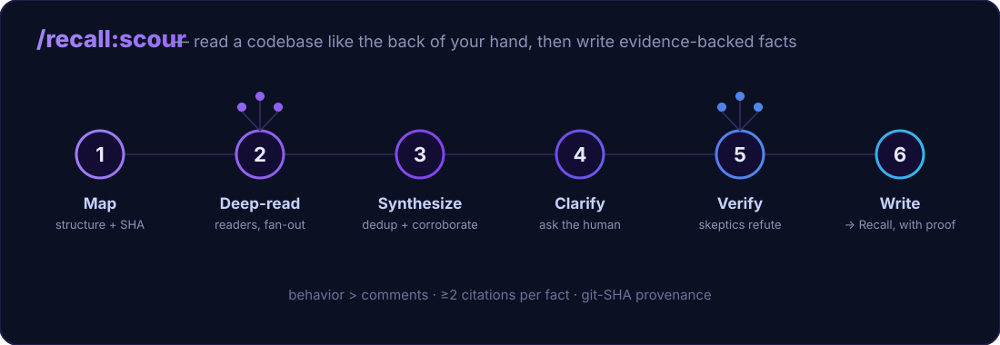

<div align="center">


# Recall

### Shared memory for your team's AI — every agent, every project, one brain.

Stop re-explaining your codebase to Claude every session. **Recall** is a self-hosted
memory server that lets your whole team's Claude Code instances read and write the
same knowledge — your conventions, your architecture, your decisions — and recall
them by meaning, on demand.

[](LICENSE)
[]()
[]()
[]()

</div>

---

## Why Recall

Most AI memory tools make one agent remember one session a little better. Recall solves the
harder problem:

> **Many people. Many agents. Many projects. One shared, governed memory pool — on infrastructure you own.**

| | Recall |
|---|---|
| 🧠 **Team-shared** | One pool, role-scoped (owner / admin / dev / viewer) |
| 🗂️ **Multi-project** | Isolated per-project memory + a `global` scope for org-wide conventions |
| 🔒 **Self-hosted** | Postgres + an optional **local** embedder. Your data never has to leave your network |
| 🔌 **MCP-native** | Claude calls `recall_*` tools itself — no copy-paste, no ceremony |
| 🔍 **`/recall:scour`** | Deliberately reads a codebase and writes evidence-backed facts into memory |
| 🌅 **Wakes up knowing** | A session-start brief auto-loads this repo's facts + global conventions |
| 🔁 **Auto-updates** | `/recall:track` once → every commit refreshes shared memory, hands-off |
| ♻️ **Stays fresh** | Confidence decay + staleness flags so old facts don't quietly become lies |

---

## How it works

```
   teammate's laptop                         your Recall server (one box)
 ┌────────────────────┐    MCP / HTTPS    ┌──────────────────────────────┐
 │   Claude Code      │ ────────────────▶ │  Recall API                    │
 │   (just a token)   │ ◀──────────────── │   ├─ Postgres + pgvector      │
 └────────────────────┘   relevant facts  │   └─ local embedder (Ollama)  │
                                           └──────────────────────────────┘
```

Teammates install nothing heavy — their machine just holds a token. The database and the
embedder live on **your** server. A weak laptop still gets full semantic recall, because
none of the work happens there.

---

## Quickstart

### 1 — Stand up the server (one command)
```bash
git clone https://github.com/gshepptech/recall && cd recall
./install.sh
```
`install.sh` generates secrets, builds, and launches the whole stack (Postgres + Recall), then
prints your owner token. Add semantic search anytime — `./install.sh embedder` pulls a local
model (zero egress). Expose to the team: `cloudflared tunnel --url http://localhost:8000`.

### 2 — Add a teammate
Admin mints a token:
```bash
./install.sh add-user alice developer
```
Teammate installs the plugin + connects, inside Claude Code:
```
/plugin marketplace add gshepptech/recall
/plugin install recall@recall
```
Then save creds in your terminal (token read **silently**, never in chat) and run `/recall:connect` —
steps in **[docs/TEAM-SETUP.md](docs/TEAM-SETUP.md)**. Restart Claude Code — tools + memory brief load.

> 👥 Full join guide: **[docs/TEAM-SETUP.md](docs/TEAM-SETUP.md)** (~2 minutes).

### 3 — Just talk
```
"Remember in Recall that we always return Result types, never throw across boundaries."
"What did we decide about the auth flow?"
```
Claude calls `recall_save_memory` / `recall_search` itself. No commands to memorize.

---

## ⭐ The headline feature: `/recall:scour`

<div align="center"></div>

A blank-slate memory is only as good as what you feed it. `/recall:scour` reads a repository
**like a senior engineer who's lived in it for months** — then writes high-signal, cited
facts into Recall. It does **not** glance.

- **Behavior is truth, comments are not.** Every convention is derived from what the code
  *does* — comments are read only to flag drift.
- **Evidence or it's not a fact.** Each convention cites **≥2 `file:line`** instances.
- **Traces real flows** end-to-end; reads whole files, never excerpts.
- **Asks you when it's unsure** instead of guessing intent.
- **Adversarially verified** — a skeptic pass hunts counter-examples and kills weak facts.
- **Provenance + freshness** — every fact is stamped with the git SHA it was learned at.

```bash
/recall:scour . --scope auto --depth exhaustive
```

> Ships as a Claude Code plugin in [`plugin/`](plugin/): `/recall:scour`, `/recall:connect`,
> `/recall:track` (auto-refresh on every commit), a **SessionStart auto-brief**, and the
> `recall-reader` + `recall-skeptic` agents that enforce the quality bar above.

---

## Search modes — pick your privacy

| Mode | Semantic? | Data leaves your box? | Setup |
|---|---|---|---|
| **Keyword** | — | **Never** | nothing |
| **Local embedder** (Ollama) | ✅ by meaning | **Never** | bundled in `docker-compose.yml` |
| **Cloud embedder** (OpenAI) | ✅ by meaning | fact text → OpenAI | one API key |

Local embedding is a tiny ~274 MB model on CPU — **no GPU required**, runs on the same box.

---

## What Recall remembers

| Type | For |
|---|---|
| `note` | Conventions & "how we write code here" (and anti-patterns) |
| `decision` | Choices the team committed to, and why |
| `requirement` | How a feature is supposed to work |
| `prompt` | Reusable, named style rules |
| `conversation` | Session diaries (optional server-side auto-capture) |

---

## Configuration

Copy `.env.example` → `.env`. The essentials:

| Variable | Purpose |
|---|---|
| `RECALL_TOKEN` | Owner bearer token |
| `DB_BACKEND` | `sqlite` (solo) or `postgres` (team) |
| `RECALL_EMBED_DIM` | Vector size — **must match your embedder** (nomic `768`, OpenAI-large `3072`) |
| `OPENAI_API_BASE` | Point at a local embedder for zero-egress semantic search |

---

## Deploy notes

- **Solo / trial:** SQLite, keyword-only — zero dependencies.
- **Team:** Postgres + pgvector (bundled compose) + a Cloudflare tunnel or Tailscale.
- **Tiny footprint:** a ~€6/mo VPS or any always-on machine runs this comfortably.

---

## Credits

Recall is a fork of [**Zikra**](https://github.com/getzikra/zikra) (MIT) by Mukarram, extended
with a config-driven embedder, a bundled local-embedding option, and the `/recall:scour`
codebase-comprehension engine. Huge thanks to the original project.

Licensed under [MIT](LICENSE).
