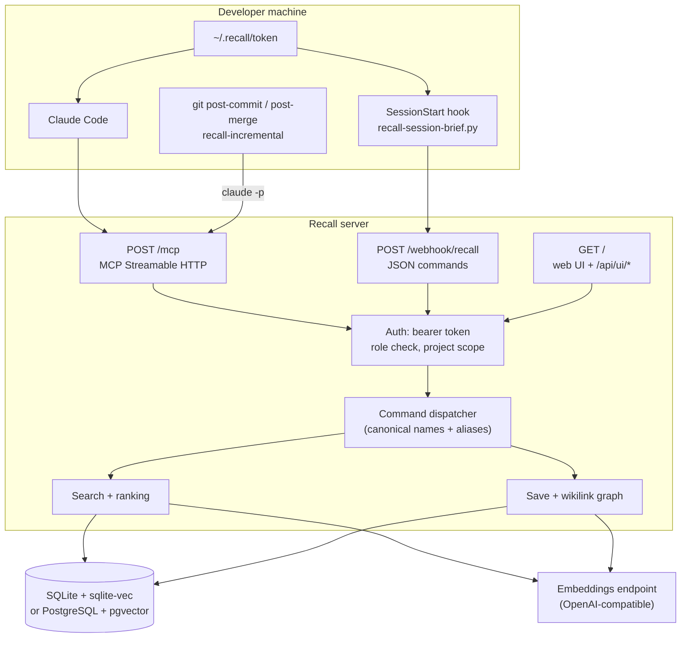
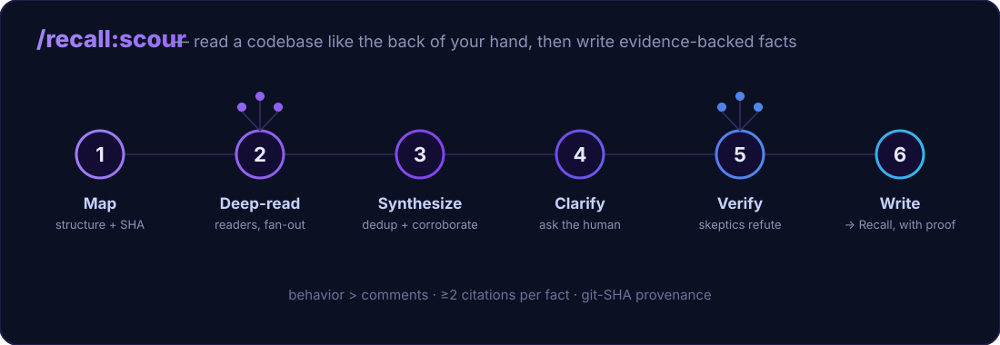
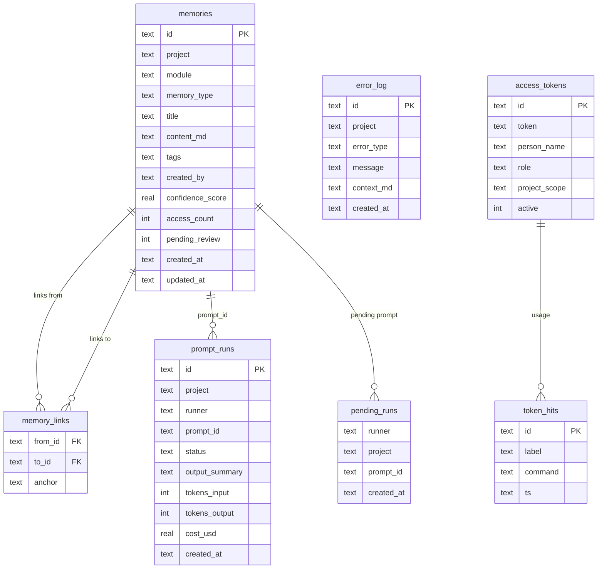

# Recall architecture

Recall has two parts: a memory server and a Claude Code plugin that feeds it and reads
from it. This page describes how each works and how data moves between them.

## Overview

## Server

The server is a FastAPI app started with `python -m recall`. It runs schema migrations at
startup, then serves three surfaces:

| Surface | Path | Used by |
|---|---|---|
| MCP tools | `POST /mcp` (Streamable HTTP); `/mcp/sse` and `/mcp/messages` for older SSE clients | Claude Code and other MCP clients |
| Command API | `POST /webhook/recall` | The session brief, scripts, `curl`, non-MCP agents |
| Web UI | `GET /` and `GET /api/ui/*` | People browsing memory in a browser |
| Health | `GET /health` | Docker health check, `install.sh` |

Both the MCP tools and the command API call the same handlers in `recall/commands/`.
The command API also accepts aliases such as `find`, `remember` and `store`, so agents
that guess a command name still reach the right handler. [commands.md](commands.md)
lists every command.

### Auth

Every request carries a bearer token. The owner token comes from `RECALL_TOKEN` in the
environment. All other tokens live in the `access_tokens` table and are created with
`create_token`, which only the owner can call. Each token has a role:

| Role | Adds |
|---|---|
| viewer | Search and read |
| developer | Save memories, prompts and requirements; log runs and errors |
| admin | Delete memories, read the schema, debug output |
| owner | Mint tokens |

A token can also carry a `project_scope`. Requests for any other project are rejected
with `403 token_scope_mismatch`, and lookups by id are limited to that project.

### Storage

`recall/db.py` is the storage API the commands call. Each function dispatches to one of
two backends:

- **SQLite** (default). FTS5 handles keyword search and `sqlite-vec` handles vectors.
  Good for one person on one machine. Memory writes and search live in
  `recall/db_sqlite_search.py`.
- **PostgreSQL + pgvector** (`RECALL_DB_BACKEND=postgres`). `tsvector` handles keyword
  search, and an HNSW index on a `halfvec` column handles vectors. The Docker stack uses
  this backend so several agents can write at once. The schema and the other queries live
  in `recall/db_postgres.py`; memory writes and search live in `recall/db_postgres_search.py`.

The PostgreSQL vector column is sized by `RECALL_EMBEDDING_DIM` and must match the
embedding model. `./install.sh embedder` resizes it to 768 for `nomic-embed-text`.

### Embeddings

`recall/embed.py` calls any OpenAI-compatible `/embeddings` endpoint, such as hosted
OpenAI or a local Ollama. If no key is set, or the call fails, Recall stores the memory
without a vector and search runs keyword-only. Search responses then include
`"degraded": true` and a warning.

### Search and ranking

1. The query is embedded if an embedder is configured.
2. Vector and full-text candidates are fetched for the project (`global` searches every
   project) and merged into a raw relevance score between 0 and 1. That score is returned
   as `relevance`.
3. Results below the relevance floor are dropped. The floor is `RECALL_MIN_RELEVANCE`
   (off by default) or a per-request `min_relevance`. The response reports how many
   matches it dropped in `suppressed_low_relevance`, so an agent can tell "nothing
   relevant" apart from "nothing stored".
4. The remaining results are re-ranked: raw score × recency decay (half-life
   `RECALL_DECAY_DAYS`) × an access-count boost × the memory's stored confidence.
5. Snippets are trimmed to fit `max_tokens`.

Confidence is a number from 0 to 1 that the writer sends with `confidence` on a save. It
is stored as `confidence_score` and kept on later saves that do not send one.
`/recall:scour` sets it from the reader's confidence after the skeptic pass, so facts that
barely survived rank below well-supported ones.

`python -m recall.tests.eval_retrieval` seeds a labelled corpus into a temporary server
and reports recall@k, precision@k and a sweep of relevance floors. Use it to check a
ranking change before merging it.

### Saves and links

A save upserts on `(title, memory_type, project)`, so saving the same title again updates
the memory rather than adding a copy. Title and content are embedded together. Any
`[[Title]]` in the content becomes an edge in `memory_links`, which the web UI draws as a
graph and `get_memory` returns as backlinks.

## Claude Code plugin

The plugin in `plugin/` adds three slash commands, two agents and one hook.

### `/recall:connect`

Reads `RECALL_URL` and `RECALL_TOKEN` from `~/.recall/token` and runs
`claude mcp add --transport http recall "$RECALL_URL/mcp"` at user scope. The token is
passed by variable, so it never appears in the conversation. User scope matters because
the commit hooks run `claude -p` outside any project.

### SessionStart brief

`plugin/scripts/recall-session-brief.py` runs when a session starts. It takes the repo's
directory name as the project, asks `/webhook/recall` for the top global and project
memories, and prints a short Markdown brief that Claude Code adds to the context. It
exits silently on any error, so a down server never blocks a session.

### `/recall:scour`

A deliberate, multi-agent read of a codebase:

1. **Map:** Record the commit SHA and cut the repo into slices.
2. **Deep-read:** One `recall-reader` agent per slice returns candidate facts. Each
   convention needs at least two `file:line` citations.
3. **Synthesize:** Merge, corroborate across slices, and check Recall for near-duplicates.
4. **Clarify:** Ask the user about anything ambiguous instead of guessing.
5. **Verify:** A `recall-skeptic` agent tries to refute each important fact against the
   code. Facts that fail are dropped or downgraded.
6. **Write:** Save survivors with their citations, the SHA, a `source:scour` tag and a
   confidence score.

### `/recall:track`

Copies `recall-incremental` to `~/.recall/bin/` and appends a marked block to the repo's
`post-commit` and `post-merge` hooks. It respects `core.hooksPath` and leaves any existing
hook content alone. On each commit or merge, the script lists changed source files and
runs a headless `claude -p` with a strict prompt. That run reads only those files, keeps
only facts with two or more citations, skips anything ambiguous, and saves through the
MCP tools. It runs in the background and logs to `~/.recall/incremental.log`, so a commit
never waits on it.

## Data model

`prompt_runs` and `pending_runs` link a prompt fetched with `get_prompt` to the run an
agent logs afterwards with `log_run`, so the web UI can show which prompts were run, by
whom, and at what token cost. Migrations live in `recall/migrations/` for SQLite and in
`recall/db_postgres.py` for PostgreSQL.
